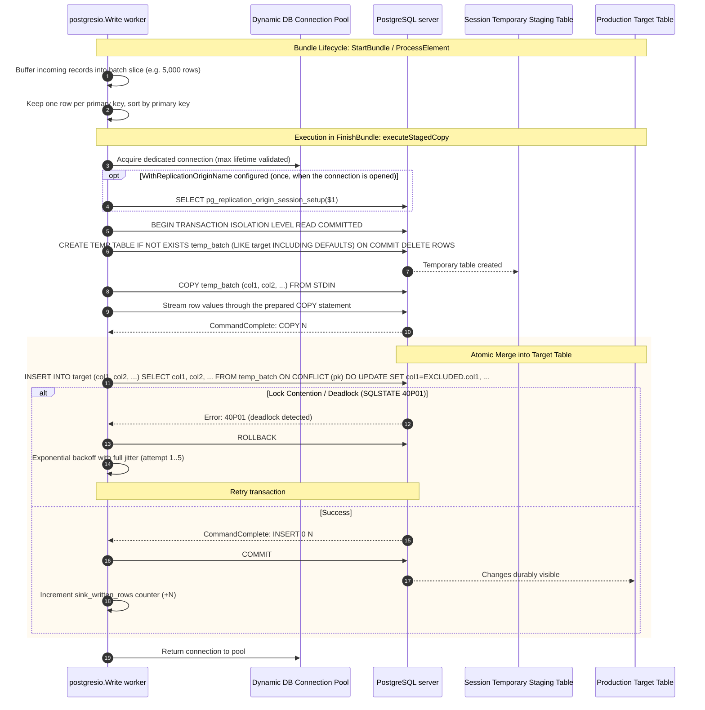

<!--
    Licensed to the Apache Software Foundation (ASF) under one
    or more contributor license agreements.  See the NOTICE file
    distributed with this work for additional information
    regarding copyright ownership.  The ASF licenses this file
    to you under the Apache License, Version 2.0 (the
    "License"); you may not use this file except in compliance
    with the License.  You may obtain a copy of the License at

      http://www.apache.org/licenses/LICENSE-2.0

    Unless required by applicable law or agreed to in writing,
    software distributed under the License is distributed on an
    "AS IS" BASIS, WITHOUT WARRANTIES OR CONDITIONS OF ANY
    KIND, either express or implied.  See the License for the
    specific language governing permissions and limitations
    under the License.
-->

# Apache Beam Go SDK: PostgreSQLIO (`postgresio`)

`postgresio` is a native Apache Beam Go SDK I/O connector providing high-throughput writing and upserts for PostgreSQL. It operates without Java Virtual Machine (JVM) dependencies or cross-language serialization overhead.

> [!NOTE]
> The connector is experimental. See [Known Limitations](#known-limitations).

---

## Table of Contents

1. [Architectural Overview](#1-architectural-overview)
2. [Subsystem Architecture](#2-subsystem-architecture)
   - [A. High-Throughput Write Engine](#a-high-throughput-write-engine)
3. [Quickstart & Getting Started](#3-quickstart--getting-started)
   - [Native Go Write & Upsert](#native-go-write--upsert)
4. [Configuration Reference](#4-configuration-reference)
   - [Options](#options)
   - [Required privileges](#required-privileges)
   - [Security & TLS Configuration](#security--tls-configuration)
   - [Known Limitations](#known-limitations)

---

## 1. Architectural Overview

```
 PCollection<T>
       |
       v
+------------------------------------------------------------+
| postgresio.Write                                           |
|   per bundle: buffer rows; flush by count, bytes, interval |
|   per batch:  keep one row per primary key; sort by key    |
|   execute:    staged COPY + INSERT ... ON CONFLICT         |
|               or parameterized UNNEST                      |
|   deadlock:   retry with jittered exponential backoff      |
+------------------------------+-----------------------------+
                               |
              +----------------+----------------+
              v                                 v
   WriteResult.SuccessfulRows        WriteResult.FailedRows
                                     (rows the database rejected)
```

### Staged COPY Upsert Sequence Diagram



---

## 2. Subsystem Architecture

### A. High-Throughput Write Engine
* **Staged COPY Upsert (`WriteMethodStagedCopy`, Default)**: Streams micro-batched tuples through a prepared `COPY <staging> (<columns>) FROM STDIN` into a session-scoped temporary table (`CREATE TEMP TABLE IF NOT EXISTS <staging> (LIKE target INCLUDING DEFAULTS) ON COMMIT DELETE ROWS`). The staging table is created once per session and emptied at each commit rather than created and dropped per batch, so steady-state flushes execute no catalog DDL. Once streamed, an atomic set-based merge (`INSERT INTO target SELECT ... FROM <staging> ON CONFLICT DO UPDATE SET ...`) applies the batch, so per-row statements are never parsed or planned.
* **Parameterized `UNNEST` Array Upsert (`WriteMethodUnnest`)**: Executes batch inserts and upserts via vectorized array parameters with explicit type casts (`UNNEST($1::bigint[], $2::text[], ...)`), providing fallback execution when temporary table creation is restricted.
* **Batching and deadlocks**: Within a batch, a primary key that appears more than once is kept once, because PostgreSQL rejects a statement that affects the same row twice (SQLSTATE `21000`). The surviving row is the later arrival in the bundle, which is not event order, and nothing coordinates across bundles or workers. **Write does not decide which version of a row wins**; if your pipeline needs the latest version to win, establish that before `Write`, for example with a stateful DoFn keyed by primary key. Each batch is sorted by primary key so concurrent writers take row locks in the same order, which reduces `40P01` deadlocks; a write that still deadlocks is retried with backoff.
* **Declarative Replication Origin Stamping**: Users can configure `.WithReplicationOriginName("beam_origin")`. Each pooled connection selects the origin once via `SELECT pg_replication_origin_session_setup($1)`, so every WAL record the sink produces carries that origin. A peer subscription declared `WITH (origin = none)` then skips those changes, breaking the cyclic feedback loop in active-active bidirectional synchronization. The origin must already exist (`SELECT pg_replication_origin_create('beam_origin')`) and the role needs the privilege described under [Required privileges](#required-privileges).
* **Connection Pool Management & CVE-2018-1058 Mitigation**: Clamps worker connection pools to 2 connections by default to prevent connection storms. Automatically injects `search_path=pg_catalog,pg_temp` into every connection DSN, closing search-path hijacking vulnerabilities across all pool connections.
* **Dead-Letter Queue (DLQ)**: Separates successfully committed rows from rejected records, appending sanitized error messages and PostgreSQL SQL states without credential leakage. Every failure has exactly one outcome. A batch rejected by the *server* (a constraint violation, say) is emitted to `FailedRows` and the bundle continues. A batch that the current *configuration* can never write correctly — `MERGE` on the `UNNEST` path, `MERGE` over a partial row, or a row type naming a column that does not exist — fails the bundle instead, because retrying it against the same configuration would fail identically, and draining it to the DLQ would report success while hiding a misconfiguration. The DLQ is batch-granular: the failing statement is set-based, so PostgreSQL does not report which input row caused the error, and a job reprocessing the DLQ must expect already-applied rows in it.

## 3. Quickstart & Getting Started

### Native Go Write & Upsert

```go
package main

import (
	"context"
	"flag"

	"github.com/apache/beam/sdks/v2/go/pkg/beam"
	"github.com/apache/beam/sdks/v2/go/pkg/beam/io/postgresio"
	"github.com/apache/beam/sdks/v2/go/pkg/beam/x/beamx"
)

type Order struct {
	OrderID     int64   `beam:"order_id" db:"order_id"`
	CustomerID  string  `beam:"customer_id" db:"customer_id"`
	Amount      float64 `beam:"amount" db:"amount"`
	Status      string  `beam:"status" db:"status"`
}

func main() {
	flag.Parse()
	beam.Init()

	p, s := beam.NewPipelineWithRoot()

	orders := []Order{
		{OrderID: 101, CustomerID: "CUST-1", Amount: 250.50, Status: "COMPLETED"},
		{OrderID: 102, CustomerID: "CUST-2", Amount: 89.00, Status: "PENDING"},
	}
	input := beam.CreateList(s, orders)

	result := postgresio.Write(s, "test_pipelines.target_orders", input,
		postgresio.WithHost("localhost"),
		postgresio.WithPort(5432),
		postgresio.WithDatabase("postgres"),
		postgresio.WithUsername("beam_navigator"),
		postgresio.WithPassword("beam_password"),
		postgresio.WithPrimaryKeyColumns("order_id"),
		postgresio.WithWriteMode(postgresio.WriteModeUpsert),
		postgresio.WithBatchSize(5000),
	)
	_ = result // result.FailedRows carries rows the database rejected.

	if err := beamx.Run(context.Background(), p); err != nil {
		panic(err)
	}
}
```

## 4. Configuration Reference

### Options

| Option | Default | Purpose |
| :--- | :--- | :--- |
| `WithHost(string)` | `""` | Target PostgreSQL host or IP |
| `WithPort(int)` | `5432` | Target PostgreSQL port |
| `WithDatabase(string)` | `""` | Target database name |
| `WithUsername(string)` | `""` | Database user role |
| `WithPassword(string)` | `""` | Database password |
| `WithSSLMode(string)` | `verify-full` | SSL connection mode (`disable`, `require`, `verify-ca`, `verify-full`) |
| `WithSSLRootCert(string)` | `""` | SSL root certificate file path or PEM data for verify-ca/verify-full |
| `WithWriteMode(WriteMode)` | `WriteModeUpsert` | Mutation strategy: `WriteModeInsert`, `WriteModeUpsert`, `WriteModeUpdate`, `WriteModeMerge` |
| `WithPrimaryKeyColumns(...string)` | `nil` | Primary key columns used for `ON CONFLICT` resolution |
| `WithUpdateFields(...string)` | `nil` | Subset of columns to set under `WriteModeUpsert` / `WriteModeUpdate`, defaulting to all non-PK columns. Matched exactly and case-sensitively; rejected at construction if a name matches no column, or if the write mode has no `SET` clause |
| `WithBatchSize(int)` | `5000` | Maximum rows per micro-batch flush |
| `WithMaxBatchBytes(int)` | `8388608` (8 MB) | Maximum bytes per micro-batch flush |
| `WithFlushInterval(Duration)` | `1s` | Maximum time between micro-batch flushes |
| `WithPgBouncer(bool)` | `false` | Avoids session state under PgBouncer transaction pooling (downgrades Staged COPY to parameterized UNNEST) |

### Column mapping

Each exported struct field maps to one column. The name comes from the first
of the `db`, `beam` and `json` tags that names one; a tag of `"-"` excludes
the field. A field with none of these tags maps to the snake_case form of its
Go name, so `CustomerID` maps to `customer_id`.

### Required privileges

Grant the narrowest set for the paths you actually use. Every entry below is
required by a statement this connector issues; missing one surfaces as a
`permission denied` error at worker startup or on the first flush, not at
pipeline construction.

#### Writing (`postgresio.Write`)

| Privilege | Scope | Required for | Why |
| --- | --- | --- | --- |
| `SELECT` | target table | **always** | `Setup` runs `SELECT * FROM <target> LIMIT 0` to learn the column types it needs for the `UNNEST` casts. |
| `INSERT` | target table | **always** | Every write mode inserts. |
| `UPDATE` | target table | `WriteModeUpsert`, `WriteModeUpdate`, `WriteModeMerge` | `ON CONFLICT DO UPDATE` and `MERGE ... WHEN MATCHED THEN UPDATE`. |
| `DELETE` | target table | `WriteModeMerge` with an op column that can carry deletes | `MERGE ... WHEN MATCHED THEN DELETE`. |
| `TEMPORARY` | database | `WriteMethodStagedCopy` (the default) | `CREATE TEMP TABLE` for the staging table. Granted to `PUBLIC` by default, so this usually needs no action — but a hardened database that has run `REVOKE TEMPORARY ON DATABASE ... FROM PUBLIC` must grant it back or select `WriteMethodUnnest`. |

`ON CONFLICT` additionally requires `SELECT` on every column it reads, which
includes the conflict-target (primary key) columns and each column read from
`excluded`. Since the sink already needs table-wide `SELECT` for type
inspection, a single table-level grant covers it:

```sql
GRANT SELECT, INSERT, UPDATE ON public.orders TO beam_writer;
-- Only if TEMPORARY has been revoked from PUBLIC:
GRANT TEMPORARY ON DATABASE appdb TO beam_writer;
```

> [!IMPORTANT]
> `WithReplicationOriginName` needs more than table privileges. Each connection
> runs `SELECT pg_replication_origin_session_setup($1)`, and use of the
> replication origin functions is **superuser-only by default**. The origin must
> also already exist. Either grant execute explicitly:
>
> ```sql
> SELECT pg_replication_origin_create('beam_origin');  -- superuser, once
> GRANT EXECUTE ON FUNCTION pg_replication_origin_session_setup(text) TO beam_writer;
> ```
>
> or run the sink as a superuser. Without this the connection is refused rather
> than silently opened unstamped, because an unstamped write is exactly the one a
> bidirectional peer replays back.

### Security & TLS Configuration

`NewCDCOptions` defaults `sslmode` to `verify-full`. `verify-ca` is available
for deployments whose DNS topology makes hostname verification impractical,
such as private endpoints; it is not a performance optimization.

Supported modes and what each one actually guarantees:

| `sslmode` | Encrypted | Chain verified | Hostname verified | Use when |
| :--- | :---: | :---: | :---: | :--- |
| `disable` | No | No | No | Unix socket, or an already-encrypted overlay network. Must be a deliberate choice. |
| `require` | Yes | No | No | Encryption only. Does not authenticate the server, so it does not stop a man-in-the-middle. |
| `verify-ca` | Yes | Yes | No | Hostname verification is impossible for topology reasons — private endpoints, connecting by IP, a proxy or PgBouncer presenting a different name, SSH tunnels, Kubernetes service names. |
| `verify-full` | Yes | Yes | Yes | **Everything else. This is the correct default.** |

**Why `verify-full` rather than `verify-ca`.** The two modes cost the same. Both perform the same handshake, key exchange, certificate chain validation, and symmetric bulk encryption; `verify-full` additionally matches the hostname against the certificate's SAN entries, which is one comparison performed once at handshake. PostgreSQL's own documentation assigns the two modes identical overhead. Because the CDC source holds a single replication connection for the lifetime of the pipeline, even that one-time cost amortizes to nothing.

The security difference is not small. Managed PostgreSQL providers sign every tenant's server certificate with a shared regional CA, so under `verify-ca` a certificate issued to **any other customer of the same provider** passes validation. The PostgreSQL documentation states the case directly: *"If a public CA is used, `verify-ca` allows connections to a server that somebody else may have registered with the CA. In this case, `verify-full` should always be used."* Hostname verification is the control that closes this, and it is precisely the part `verify-ca` omits.

Google Cloud SQL documents `sslmode=verify-full` and added per-instance CAs and custom SAN values specifically to support it. Azure Database for PostgreSQL recommends full certificate and hostname verification, offering `verify-ca` only where Private Endpoint DNS makes hostname matching impossible. The `prefer` default in libpq is inherited backwards compatibility, and upstream explicitly describes it as *"not recommended in secure deployments."*

### Known Limitations

The connector is experimental. The list below is what is still open.

| Area | Limitation | Impact |
| :--- | :--- | :--- |
| **`search_path`** | The write path pins `search_path=pg_catalog,pg_temp` on every pooled connection to close CVE-2018-1058, so an unqualified table name cannot resolve. | Table names must be written as `schema.table`. `postgresio.Write` rejects an unqualified name when the pipeline is constructed. |
| **Driver** | Built on `lib/pq`. | Protocol features not implemented in `lib/pq` are unavailable. |
